<p align="center">
  
</p>

I'm a software engineer who grew up in the world of machine learning and data science: forecasting demand, catching ad fraud, reading public sentiment and pricing ads for thousands of publishers.

These days I'm an **applied AI engineer**. I turn LLMs into systems people actually use: agents, retrieval, evaluation, and the plumbing that keeps them reliable in production.

I still love data. Most good AI work starts with a messy table and an honest question.

**Tools I reach for**

`Python` `PyTorch` `LangChain` `OpenAI` `Anthropic` `FastAPI` `PostgreSQL` `Spark` `Airflow` `AWS`

**Say hello**

[atif-aziz.vercel.app](https://atif-aziz.vercel.app) · [LinkedIn](https://linkedin.com/in/atif624) · [atifaziz3481@gmail.com](mailto:atifaziz3481@gmail.com)

```sql
SELECT * FROM problems WHERE interesting = TRUE;  -- open to applied AI work and consulting
```
